# Architecture

## Container View

The current product runs as two applications and one data store in one learner-local Docker deployment.

### Container Responsibilities

| Container          | Responsibilities                                                                                                                                                                                           |
| ------------------ | ---------------------------------------------------------------------------------------------------------------------------------------------------------------------------------------------------------- |
| `exercise catalog` | Serves the exercise request interface and API; matches requests to prepared exercises; checks workspace readiness before returning a link; owns the in-memory catalog metadata                            |
| `debug workspace`  | Serves the browser-based VS Code application; runs Python, pytest, and the debugger; reads and changes the learner's current exercise; owns the running editor and debugger session state                  |
| `workspace store`  | Stores the learner's current exercise files and editor configuration; preserves those files when the applications restart; replaces that state with the prepared buggy exercise when the learner resets it |

## Diagrams And Legends

Solid blue boxes are applications the team deploys, the green cylinder is a data store the team deploys, and the dashed grey box is an external system. Each solid arrow is labelled with the protocol and data that crosses it.

The image is [`container.svg`](container.svg), and its Mermaid source is [`container.mmd`](container.mmd). The image is generated with Mermaid.
